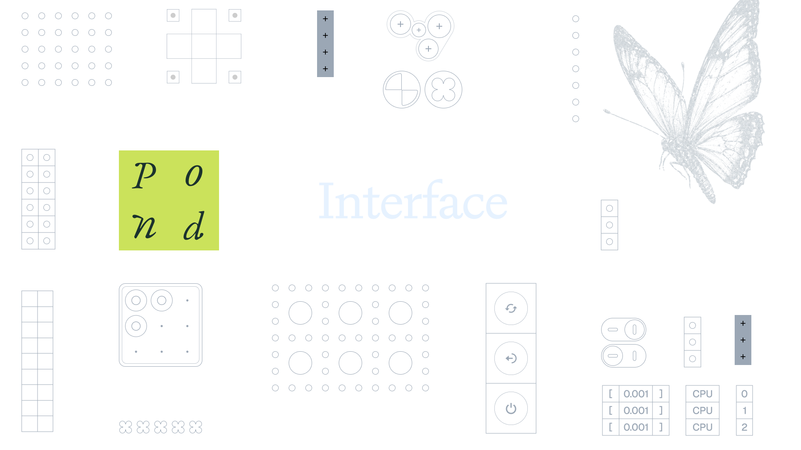
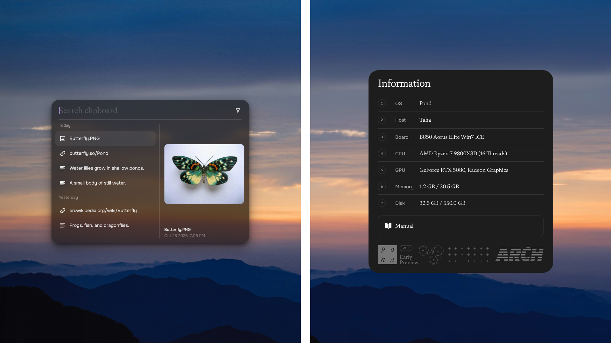
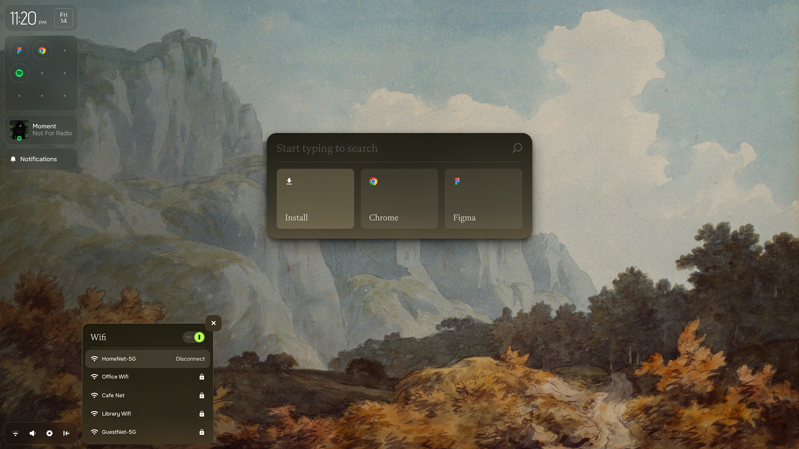

# Pond Interface

The interface for [Pond](https://www.butterfly.so/pond), a Linux operating system by Butterfly Interaction, Inc.

This repo features the core interface elements of Pond:
- Dynamic sidebar that adapts to context and brings useful information into one place. 
- Unique components such as the Minimap for managing easily managing your Niri windows. 
- Custom lock screen
- Boot menu
- Dialogs and modals
- Wallpapers

---

<video src="./Lockscreen.mp4" controls preload="metadata" aria-label="Pond lock screen demo"></video>

# License

The source code is licensed under the [BSD 3-Clause License](https://github.com/bflycomputer/pond-interface/blob/main/LICENSE).

Pond Gramercy is licensed to Butterfly Interaction, Inc. by ABC Dinamo. The font files may not be redistributed.

---

[Website](https://www.butterfly.so/pond) | [X](https://x.com/bflycomputer) | [IG](https://instagram.com/bflycomputer/)
